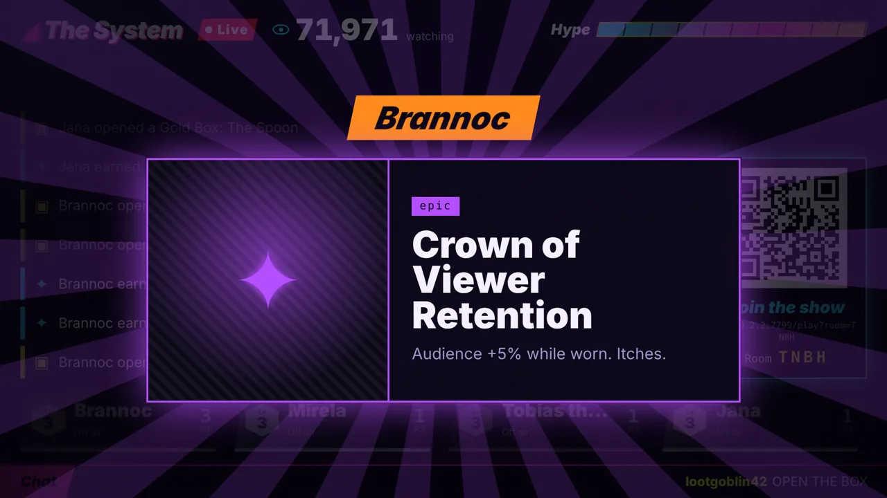
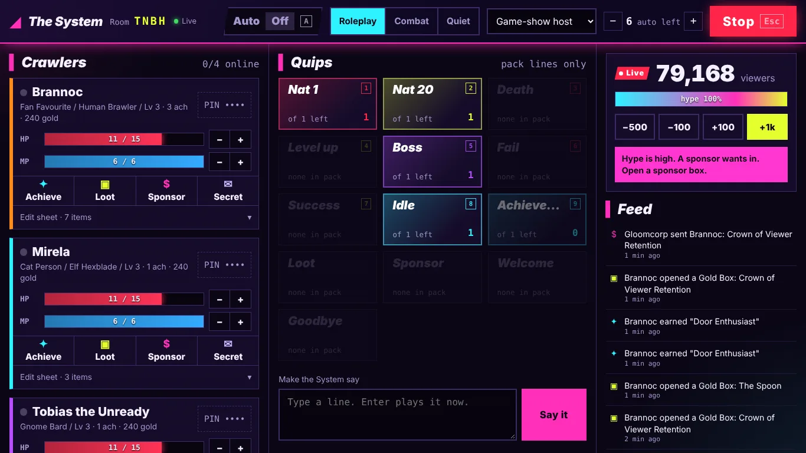
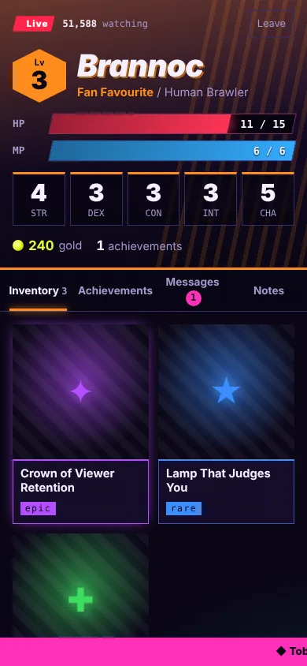

# The System

**A free, local-first game-show AI for tabletop RPG nights.**
Your TV becomes an intergalactic reality-show broadcast, every player's phone becomes their character
interface, and a smug System voice hands out achievements, loot boxes and roasts — while the GM keeps
a finger on the kill switch.



| GM desk (notebook) | Player phone |
|---|---|
|  |  |

## What it does

- **Broadcast on the TV** — live viewer counter, hype meter, audience chat ticker, big achievement and loot-box reveals, QR code to join.
- **Phones as character sheets** — stats, HP/mana, level, gold, inventory with item art, achievements, secret messages, notes. Events vibrate and take over the screen.
- **GM desk** — one-tap classic lines (nat 1, nat 20, death, boss…) with keyboard shortcuts, live stat editing, loot and sponsor boxes, secret messages, voice switcher, AUTO switch and a big STOP.
- **Never talks over your table** — lines queue by priority; spontaneous AI lines are rationed, previewed and vetoable.
- **Costs nothing by default** — no account, no cloud, no API key needed. Optional AI is capped per session.
- **Content packs** — the engine is setting-agnostic. Bring your own achievements, loot and voice lines as JSON.

## Quick start

Needs [Node.js](https://nodejs.org) 20+ on the laptop connected to your TV.

```bash
git clone https://github.com/boart31-ctrl/DCC-AI.git
cd DCC-AI
npm install
npm start
```

The console prints three links (also saved to `data/links.txt`):

1. **GM link** — open on the laptop screen.
2. **Stage link** — open in a second browser window, drag it to the TV (extended display), press `F` for fullscreen, click *Start the broadcast* once to unlock audio.
3. **Join** — players scan the QR code on the TV (same Wi-Fi) and type the PIN the GM gives them. Tip: "Add to Home Screen" makes it feel like an app.

GM shortcuts: `1–9` quips, `A` toggle AUTO, `Esc` stop everything. Stage: `F` fullscreen, `Q` hide QR.

## On the internet (Cloudflare, free plan)

The same game runs as a Cloudflare Worker with one SQLite-backed Durable Object per campaign
(`cloud/worker.js`), speaking the same WebSocket protocol. Every action is written to SQLite before it is
acknowledged; restore points, a GM restore button and session/campaign export are built in.

```bash
node tools/build_cloud.mjs packs/demo dist-cloud   # → dist-cloud/{assets,worker,wrangler.jsonc}
npx wrangler dev --config dist-cloud/wrangler.jsonc --var GM_KEY:pick-a-long-key
npm run test:cloud                                  # end-to-end: wrangler dev, crash + restart, restore
```

Logins: GM key (secret `GM_KEY`), a personal QR link per player (`/p/<token>`), TVs pair with a 4-letter
code shown at `/tv`. Details in [docs/PROTOCOL.md](docs/PROTOCOL.md) §1. A private content repo deploys by
installing this repo as a dependency and running `tools/build_cloud.mjs <pack> dist` in its build step.
The Node edition accepts the same logins (set `GM_KEY` in `.env`) next to the room + PIN flow.

## Your own content

Copy `packs/demo`, edit the JSON, start with `PACK_DIR=path/to/your-pack npm start`.
The format is documented in [docs/CONTENT_PACKS.md](docs/CONTENT_PACKS.md).
Packs made from books you own belong in a **private** repo — never publish commercial text or art.

Art: generate bulk sheets (grids of icons or portraits, boss splashes, GIFs), then
`python3 tools/art_ingest.py <image> --sheet <id> --pack <pack>` slices, crops, keys and converts them and
wires them into the pack JSON and `ui.json` (see [docs/ART_PIPELINE.md](docs/ART_PIPELINE.md)). The older
`tools/process_art.py <pack>` (single images and 2×2 grids from `<pack>/images/raw/`) still works.

## Optional AI

Copy `.env.example` to `.env` and set `ANTHROPIC_API_KEY`. Used only for custom achievement text now,
and later for the AI director. Hard-capped by `AI_MAX_CALLS` per session. Keys never leave the host.

## Roadmap

See [SPEC.md](SPEC.md). Next: pre-rendered voice packs, the "Floor 0" playtest, then the System
listening to the table (local speech-to-text, transcript only, never stored audio).

## Docs

- [SPEC.md](SPEC.md) — design and principles
- [docs/PROTOCOL.md](docs/PROTOCOL.md) — WebSocket protocol
- [docs/CONTENT_PACKS.md](docs/CONTENT_PACKS.md) — content pack format
- [docs/ART_PIPELINE.md](docs/ART_PIPELINE.md) — bulk art sheets → pack (slicing, cut-outs, animations, ui.json)

## License

Code: MIT. Demo pack content: CC-BY-4.0. Unofficial fan tool, not affiliated with any publisher.
